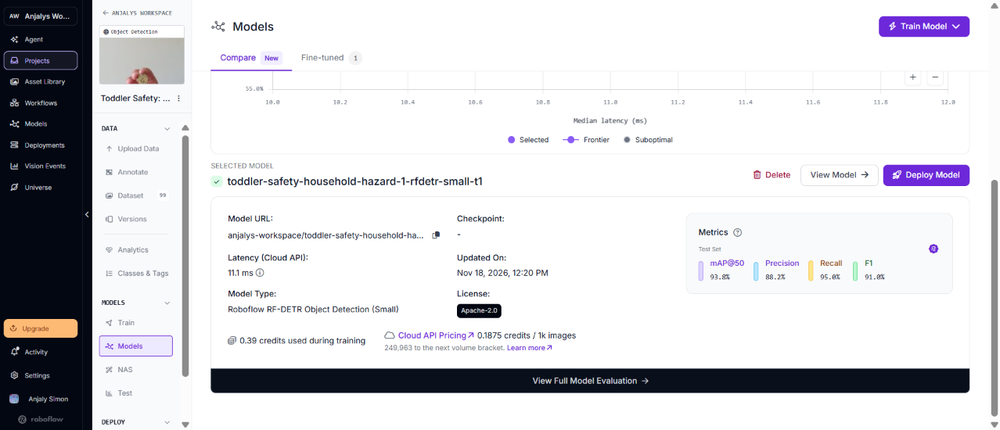
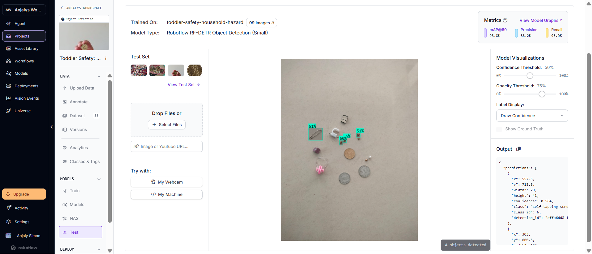

# Toddler Safety: Small Object Detection with AI

*A hands-on computer vision experiment using Roboflow*

Exploring how AI can identify small household objects that may pose risks to curious toddlers.

---

As a parent, I constantly find myself checking the floor for small objects my curious toddler might pick up. Coins, screws, washers and tiny toy components can easily go unnoticed.

It made me wonder: Could computer vision help identify small objects in a toddler's surroundings?

I had an idea, but I didn't have much hands-on experience building computer vision models. I decided to explore it using Roboflow, a platform that makes the process of creating and training object-detection models surprisingly approachable, even for someone new to the technology.

What started as a simple experiment turned into an interesting introduction to dataset preparation, model training, evaluation and real-world testing.

## Starting with an idea, not a technical background

I created an object-detection project in Roboflow called Toddler Safety – Household Hazard Detection.

One thing I appreciated about Roboflow was how straightforward the workflow was. I could create a project, upload images, organize annotations, generate a dataset version and train a model through its interface.

I didn't need to build a training pipeline from scratch or spend time configuring a complex development environment.

For someone exploring computer vision for the first time, this made a significant difference. I could focus on understanding the experiment rather than getting stuck setting up the infrastructure.

## Building the dataset

I started with 99 annotated images:

- 67 images containing coins.
- 32 images containing small household components and toy parts.

The objects included coins, nuts, washers, machine screws and self-tapping screws.

After uploading and annotating the images, I generated a dataset version and prepared it for training.

I selected the RF-DETR Small model using Roboflow's Custom Engine, with the following configuration:

The training process was managed through Roboflow's interface, making it easy to move from the prepared dataset to a trained model.

## The initial results

The validation metrics were encouraging.

| Metric | Result |
|---|---:|
| mAP@50 | 95.8% |
| Precision | 94.5% |
| Recall | 93.9% |
| F1 score | 94.2% |

These results gave me a good starting point. However, I didn't want to evaluate the experiment based on validation metrics alone.

The real question was whether the model could identify objects in photographs it hadn't encountered during training.

## Testing beyond the validation metrics

I started uploading additional photographs through Roboflow's testing interface.

One observation stood out.

In a test image containing eight objects, the model detected only four at the default 50% confidence threshold.

Coins were particularly challenging. When I reduced the confidence threshold to 20%, the model began detecting them.

This was an interesting discovery.

The confidence threshold determines how certain the model must be before reporting a detection. Reducing it can reveal objects that were previously missed, but it can also introduce incorrect detections.

It also made me realize that a good validation score doesn't automatically translate into reliable performance on unfamiliar photographs.

The testing stage was just as important as training.

## What I would improve in the next experiment

The first version gave me a working starting point, but there are several ways I would improve it.

### 1. Expand the dataset

Ninety-nine images are a relatively small dataset for an object-detection problem intended for varied real-world environments.

I would collect considerably more images, covering different object sizes, orientations, distances and backgrounds. I would also include photographs taken under different lighting conditions.

### 2. Improve class representation

I would review the number of annotated instances in each class rather than looking only at the number of images.

Some objects may be represented more frequently than others. A more balanced dataset could help the model learn to recognize less-represented objects.

### 3. Introduce more challenging scenarios

I would deliberately include images with:

- Partially hidden objects.
- Multiple objects close together.
- Objects overlapping one another.
- Small objects against cluttered backgrounds.
- Different surfaces and lighting conditions.

These scenarios would help reveal where the model struggles.

### 4. Review annotations

I would inspect bounding boxes for consistency, particularly around small objects. Accurate and consistent annotations are important for training an object-detection model.

### 5. Experiment with augmentation

Instead of relying mainly on horizontal flipping, I would explore additional augmentations such as brightness changes, rotation, scaling and variations in image contrast.

I would evaluate whether these changes improve performance rather than assuming that more augmentation is always better.

### 6. Create a more rigorous testing process

I would maintain a separate collection of images that are never used during training or validation.

I would also compare predictions across different confidence thresholds and examine precision and recall for individual classes.

This would provide a better understanding of which objects the model detects reliably and which require further work.

## What this experiment taught me

I started with a parenting concern and ended up building and testing an object-detection model. More importantly, I discovered how accessible computer vision experimentation can be with tools such as Roboflow.

This project is an experimental prototype, not a real-time baby-monitoring system or a certified choking-hazard detector. It cannot guarantee that every small object will be detected or replace adult supervision.

I would like to take this experiment further by improving the dataset and testing more challenging scenarios to understand how model performance changes.

Sometimes, the most interesting part of building something with AI isn't getting the model to work. It's discovering what happens when you put it to the test.

If you're a parent of a toddler, you've probably heard this advice a hundred times:

"You need to have an eye on him all the time."

My mother says it often, and honestly, she isn't wrong.

But wouldn't an extra eye help?
