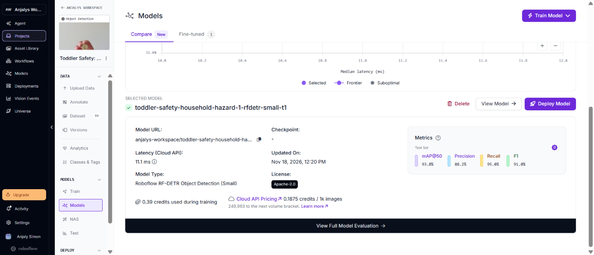

# Toddler Safety – Small Object Detection with Roboflow

**An exploratory computer vision project inspired by an everyday parenting concern.**

Could computer vision help identify small objects that toddlers might pick up?

I explored this question by building and testing an object-detection model using Roboflow.

## Project Overview

The experiment focused on detecting small household objects, including coins, nuts, washers, machine screws, and self-tapping screws.

I used Roboflow to prepare the dataset, train an object-detection model, and evaluate its predictions.

## Experiment Details

| Parameter | Details |
|---|---|
| Platform | Roboflow |
| Model | RF-DETR Small |
| Training images | 99 |
| Coin images | 67 |
| Household components and toy parts | 32 |
| mAP@50 | 95.8% |
| Precision | 94.5% |
| Recall | 93.9% |
| F1 score | 94.2% |

## Project Screenshots

### Roboflow Project

### Model Training Results

## What I Explored

- Creating an object-detection project.
- Preparing and annotating a dataset.
- Training an RF-DETR Small model.
- Understanding model evaluation metrics.
- Testing predictions on additional images.
- Investigating missed detections and confidence thresholds.
- Identifying opportunities to improve the dataset and model.

## Key Learning

The validation metrics were encouraging, but additional testing revealed missed detections, particularly for coins at the default confidence threshold.

This reinforced an important lesson: strong validation metrics do not automatically guarantee reliable performance on unfamiliar images.

## Limitations

This is an experimental prototype, not a certified choking-hazard detector or real-time baby-monitoring system. It cannot guarantee detection of every hazardous object or replace adult supervision.

## Detailed Article

Read the complete experiment, observations and potential improvements here:

[Read the full article](ARTICLE.md)
